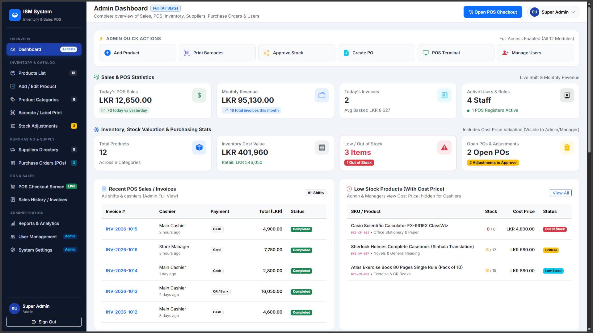
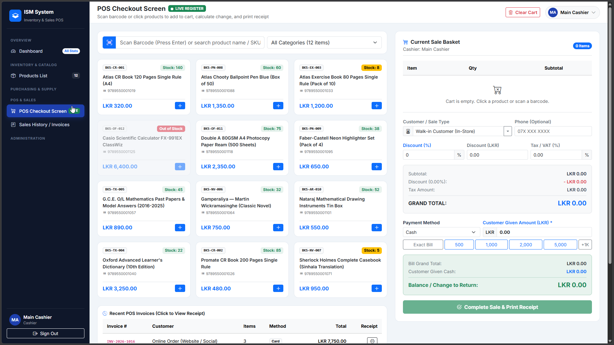

# Shop Stock & Inventory Management System (ISM)

A comprehensive, role-based retail shop stock management and Point of Sale (POS) system built with **Laravel** and **MySQL**. Designed to help retail stores eliminate stockouts, track real-time inventory, manage suppliers, process purchase orders, and handle checkout operations efficiently.

---

## 🚀 Key Features

* **Real-Time Inventory Tracking:** Monitor live stock quantities, product prices, and low-stock thresholds.
* **Point of Sale (POS) Checkout:** Fast, user-friendly billing screen designed for cashiers to process sales and manage transactions.
* **Supplier & Purchase Order Management:** Create vendor directories, generate purchase orders, and track goods shipments from delivery to restocking.
* **Dynamic Categories & Suppliers:** Organized database-driven dropdowns for clean product categorization and vendor allocation.
* **Role-Based Access Control (RBAC):** Granular permissions ensuring Admins, Store Managers, Stock Clerks, and Cashiers only access what they need.
* **Stock Adjustments & Barcode Labels:** Handle stock shrinkage, damages, and print barcode/QR price labels easily.

---

## 👥 User Roles & Permissions

| Role | Access Level |
| :--- | :--- |
| **Admin** | Full system control, user management, financial reports, and settings. |
| **Store Manager** | Oversees shop operations, approves stock adjustments, manages products and suppliers. |
| **Stock Manager** | Focuses on purchase orders, receiving shipments, product additions, and label printing. |
| **Cashier** | Restricted strictly to the POS checkout interface and shift sales history. |

---
## Screenshots

### Dashboard


### POS Screen

## 🛠️ Tech Stack

* **Backend:** PHP / Laravel Framework
* **Database:** MySQL / phpMyAdmin
* **Frontend:** Blade Templates / Tailwind CSS / JavaScript

---

## ⚙️ Getting Started & Installation

To run this project locally on your machine, follow these steps:

### Prerequisites
* PHP (v8.2 or higher recommended)
* Composer
* Node.js & NPM
* XAMPP or any local MySQL server environment

### Installation Steps

1. **Clone the repository:**
   ```bash
   git clone [https://github.com/YOUR_USERNAME/YOUR_REPOSITORY_NAME.git](https://github.com/YOUR_USERNAME/YOUR_REPOSITORY_NAME.git)
   cd YOUR_REPOSITORY_NAME
